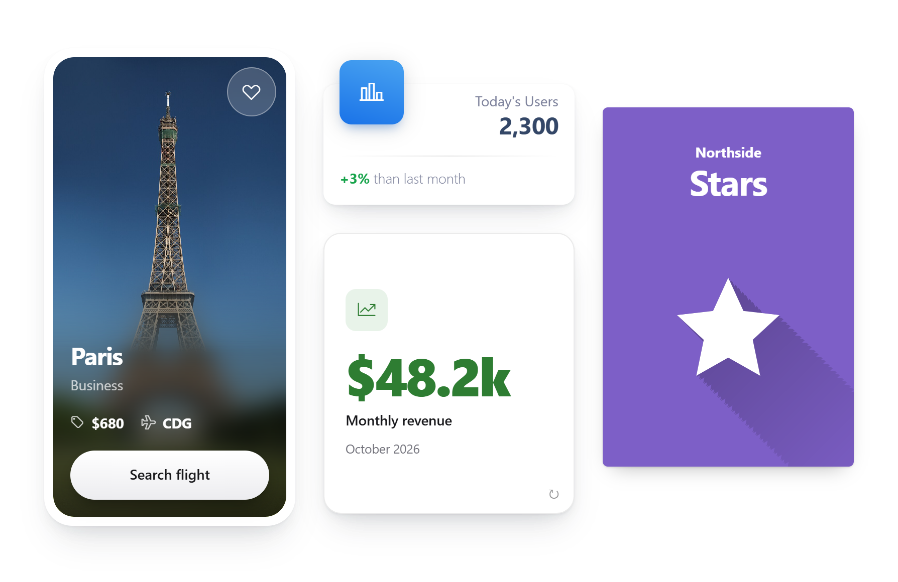

# Modern Cards for Oracle APEX

15 card designs in one template component, for report regions and single cards.

[](https://oracleapex.com/ords/r/aamirkhanz/plugins/modern-cards) &nbsp; Sign in as `demo` with the password `Demo`.



| | |
|---|---|
| **Type** | Template component plug-in |
| **Internal name** | `COM.TECHREVX.MODERN_CARDS` |
| **Version** | 2.1 |
| **Requires** | Oracle APEX 26.2 or later |
| **License** | MIT |

## What it does

Modern Cards shows your data as cards in 15 designs, from dashboard metrics to travel, product and flip cards. Pick a design, point its attributes at your columns, and Page Designer shows only the attributes that design uses.

Use it as a report region, with one card for each row of a query, or as a single card. Every design has five sizes, eight accent colors and up to three kinds of actions: a full-card link, primary buttons and secondary buttons or menus.

## At a glance

- Travel Inset / Travel Overlay: photo cards with price and code meta row, call to action and favorite button.
- **Stat**: dashboard metric with a floating accent icon tile, value, trend and footer.
- **Glass**: frosted card over a soft color mesh.
- **Glow Border**: animated gradient ring with a soft accent halo.
- **Spotlight**: dark card with a light that follows the mouse.
- **Product**: shop card with photo, badge, rating, price and cart/favorite actions.
- **Profile**: cover band in the accent color with avatar (photo or icon), bio and actions.
- **Feature**: clean bordered card with icon, text and a "learn more" style link action.
- **Neubrutalism**: thick black borders, offset shadows and bold accent background.
- **Testimonial**: star rating, quote and author with avatar.
- **Long Shadow**: flat accent card with a small Subtitle over a big Title and a huge number (Value) with a long fading diagonal shadow; set Image to show a logo instead of the number.
- Flip - Photo / Flip - Icon / Flip - Number: two-sided cards that flip on hover (tap on touch screens, focus with the keyboard). Front: photo, icon or number with title and subtitle. Back: title, description, rating, footer and actions.
- **Size**: Tiny, Small, Medium (default), Large or Extra Large scales the whole card; with Columns set to Auto it also changes how many cards fit per row.
- Every element only renders when its attribute has a value; Page Designer shows the attributes each design uses.
- **Accent values**: dark, info, success, primary, warning, danger, violet, gold.
- **Actions**: Full Card Link, Primary Actions and Secondary Actions (button or menu).
- **JavaScript**: akCards.toggle(element) toggles an action on/off and swaps an outlined icon (fa-heart-o) for the filled one.

## Installation

1. Download `plugin/template_component_plugin_com_techrevx_modern_cards.sql` from the [latest release](https://github.com/aamirkhanz/apex-plugin-modern-cards/releases/latest) (or from this repository).
2. In App Builder, open your application and go to **Shared Components > Plug-ins**.
3. Choose **Import**, select the file and finish the wizard.
4. Create a region of type **Modern Cards [Plug-in]** (or use it as a single card in a partial), map the attributes to your columns and pick a design.

Everything the plug-in needs is inside the SQL file; it loads nothing from other sites.

## Example

A report of travel destinations in the Travel - Inset design:

```sql
select id, city as title, fare_class as subtitle,
       photo_url, price, airport_code
  from destinations
```

```text
Design        Travel - Inset
Title         &TITLE.
Subtitle      &SUBTITLE.
Image         URL column PHOTO_URL
Price         &PRICE.
Code          &AIRPORT_CODE.
```

## Attributes

### Appearance

| Attribute | Type | Default | Description |
|---|---|---|---|
| **Design** (required) | Select list | `inset` | Card design. Page Designer shows only the attributes the chosen design uses. Values: `inset` Travel - Inset, `overlay` Travel - Overlay, `stat` Stat, `glass` Glass, `glow` Glow Border, `spotlight` Spotlight, `product` Product, `profile` Profile, `feature` Feature, `brutal` Neubrutalism, `testimonial` Testimonial, `jersey` Long Shadow, `flip` Flip - Photo, `flipIcon` Flip - Icon, `flipNumber` Flip - Number. |
| **Size** (required) | Select list | `md` | Card size. Scales the whole card (text, spacing, icons, photos and buttons). In a report with Columns set to Auto, smaller sizes also fit more cards per row and larger sizes fewer. Values: `xs` Tiny, `sm` Small, `md` Medium, `lg` Large, `xl` Extra Large. |
| **Accent** | Text |  | Accent color: dark, info, success, primary, warning, danger, violet or gold. Use a column substitution such as &ACCENT. to color each card differently. Shown when Design is not `inset` or `overlay` or `product` or `testimonial`. |
| **Card CSS Classes** | Text |  | Extra CSS classes added to each card. |
| **Columns** | Select list |  | Number of cards per row. Auto fits as many cards as there is room for. All options fall back to fewer columns on small screens. Values: `2` 2 Columns, `3` 3 Columns, `4` 4 Columns, `5` 5 Columns. |

### Content

| Attribute | Type | Default | Description |
|---|---|---|---|
| **Title** (required) | Text |  | Main heading: destination, metric label, product, person or quote author depending on the design. |
| **Subtitle** | Text |  | Muted line: fare class, product category, job title or the author's role. Shown when Design is not `stat`. |
| **Description** | Text |  | Body text. For the Testimonial design this is the quote. Shown when Design is not `inset` or `overlay` or `stat`. |
| **Badge** | Text |  | Short label shown as a pill, for example New, Beta or -20%. Shown when Design is not `inset` or `overlay` or `stat` or `testimonial`. |

### Media

| Attribute | Type | Default | Description |
|---|---|---|---|
| **Image** | Media |  | Photo. Travel and Product show it as the card picture, Profile and Testimonial as a round avatar. Shown when Design is `inset` or `overlay` or `product` or `profile` or `testimonial` or `brutal` or `jersey` or `flip`. |
| **Image Description** | Text |  | Alternative text read by screen readers for the photo. Shown when Image has a value. |
| **Icon** | Text |  | Font APEX icon class, for example fa-calendar, or a column substitution such as &ICON_CLASS. Profile and Testimonial use it as the avatar when there is no image. Shown when Design is not `inset` or `overlay` or `product`. |

### Details

| Attribute | Type | Default | Description |
|---|---|---|---|
| **Value** | Text |  | Big number: the metric of a Stat card, the price of a Product card or the center number of a Long Shadow card. Shown when Design is `stat` or `product` or `jersey` or `flipNumber`. |
| **Trend** | Text |  | Change shown in bold at the start of the footer, for example +55%. Shown when Design is `stat` or `flipNumber`. |
| **Trend Direction** | Text | `up` | up (green), down (red) or neutral. Use a column substitution to set it per card. Shown when Design is `stat` or `flipNumber`. |
| **Footer** | Text |  | Footer text under the divider, for example than last week. Shown when Design is `stat` or `flipNumber`. |
| **Rating** | Text |  | Number from 0 to 5, shown as stars. Decimals fill partial stars. Shown when Design is `product` or `testimonial` or `flip`. |
| **Price** | Text |  | Price shown in bold in the travel meta row, for example $120. Shown when Design is `inset` or `overlay`. |
| **Price Prefix** | Text | `from` | Shown when Price has a value. |
| **Price Icon** | Icon | `fa-tag` | Shown when Price has a value. |
| **Code** | Text |  | Short code shown in bold after the price, for example an airport code. Shown when Design is `inset` or `overlay`. |
| **Code Icon** | Icon | `fa-plane` | Shown when Code has a value. |

## Action positions

- **Full Card Link** (`FULL_CARD_LINK`): Makes the whole card a link. Buttons in the card stay clickable on their own.
- **Primary Actions** (`PRIMARY_ACTIONS`): Main call to action, shown as a full-width pill button, for example Search flight.
- **Secondary Actions** (`SECONDARY_ACTIONS`): Extra action, usually an icon-only button such as a favorite heart. Inset style shows it beside the primary action, Overlay style in the top corner of the photo.

## JavaScript

The plugin file modern-cards.js adds a small `akCards` object. Call it from an action of type Execute JavaScript Code, where `this.triggeringElement` is the clicked button.

### akCards.toggle( element )

Switches the action that contains `element` on or off, sets `aria-pressed` and swaps an outlined icon such as `fa-heart-o` for the filled one. Returns the new state and triggers the `akcardtoggle` event on the action.

```javascript
akCards.toggle( this.triggeringElement );
```

### akCards.flip( element, state )

Turns a Flip card over from code. Leave out `state` to toggle, or pass `true` or `false`. Returns whether the card now shows its back.

```javascript
akCards.flip( this.triggeringElement, false );
```

### akcardtoggle event

Fires on the action after `akCards.toggle`, with `{ active: true | false }` as data, so you can save a favorite or update a count.

```javascript
$( document ).on( "akcardtoggle", ".ak-Card-btn", function( event, data ) {
    apex.message.showPageSuccess( data.active ? "Saved" : "Removed" );
} );
```

## CSS classes

Each card is an `article.ak-Card` with classes for its settings, so you can restyle one design without touching the others. Add your own classes with the Card CSS Classes attribute.

```text
.ak-Card--stat               design (the Design value)
.ak-Card--size-lg            size: xs, sm, md, lg, xl
.ak-Card--accent-violet      accent: dark, info, success, primary, warning,
                             danger, violet, gold
.ak-Cards--cols3             report columns: 2 to 5
```

## Repository contents

- `plugin/template_component_plugin_com_techrevx_modern_cards.sql`: the plug-in, ready to import
- `src/`: the plug-in's own source (templates, CSS and JavaScript), for reading and reviewing; the SQL file already contains it
- `apexplugin.json`: the plug-in's details for [apex.world](https://apex.world)

## License

MIT, see [LICENSE](LICENSE).

## More plug-ins

Documentation, updates and more plug-ins for Oracle APEX by [TechRevX](https://www.techrevx.com).
